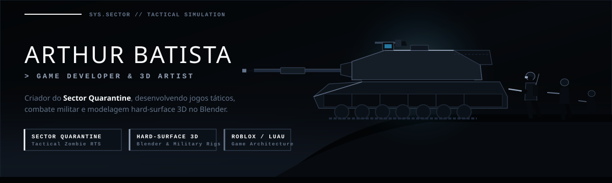

<div align="center">

  <!-- BANNER ANIMADO COM ORBE GENESIS DO JARVIS -->
  

  <br />

  <!-- TYPING SVG DINÂMICO -->
  <a href="https://github.com/ArthurBatista279">
    
  </a>

  <br />

  <!-- BADGES DINÂMICOS (ATUALIZAM AUTOMATICAMENTE) -->
  <p>
    
    <a href="https://github.com/ArthurBatista279?tab=followers">
      
    </a>
    <a href="https://github.com/ArthurBatista279?tab=repositories">
      
    </a>
    <a href="https://www.linkedin.com/in/arthur-batista-oliveira-bb8018358/">
      
    </a>
    <a href="mailto:barthur.oliveira07@gmail.com">
      
    </a>
  </p>

</div>

---

## `>_` Sobre Mim

```yaml
desenvolvedor: "Arthur Batista Oliveira"
formacao: "Desenvolvimento de Sistemas — SENAI"
foco_principal: ["Back-End Engineering (C# / .NET 10)", "Arquitetura de Software", "Runtimes de IA"]
projetos_destaque:
  autoral_genese: "JarvisIA — Arquitetura limpa em 4 camadas C# / SQLite (onde tudo começou)"
  autoral_runtime: "R.I.P.E.R. — Runtime determinístico .NET 10 com preflight JSON e 110 testes"
  open_source_mod: "Mark_LV — Customização e evolução de assistente Open Source em Python"
```

Estudante de **Desenvolvimento de Sistemas no SENAI**, com foco em **Engenharia de Software, Arquitetura Back-End e Sistemas de Inteligência Artificial**. Desenvolvo projetos aplicando separação estrita de responsabilidades em camadas, persistência relacional (**Entity Framework Core, SQLite e SQL Server / T-SQL**), validação determinística e interfaces modernas.

---

## `★` Ecossistema de Projetos em Destaque

<table>
  <thead>
    <tr>
      <th width="33%">🟡 1. JarvisIA <code>[PROJETO GÊNESE]</code></th>
      <th width="34%">🔵 2. R.I.P.E.R. <code>[.NET 10 RUNTIME]</code></th>
      <th width="33%">🟢 3. Mark_LV <code>[OPEN SOURCE MOD]</code></th>
    </tr>
  </thead>
  <tbody>
    <tr>
      <td>
        
        
        <br /><br />
        <strong>Onde tudo começou.</strong> Assistente conversacional projetado do zero em <strong>4 camadas</strong> (<code>Core</code>, <code>Infrastructure</code>, <code>Services</code>, <code>Web</code>) com memória persistente em SQLite (<code>jarvis_memory.db</code>), integração HTTP direta com LLMs e retry exponencial.
        <br /><br />
        <a href="https://github.com/ArthurBatista279/JarvisIA"><strong>→ Ver Repositório no GitHub</strong></a>
      </td>
      <td>
        
        
        <br /><br />
        <strong>O modelo propõe. O núcleo valida, executa e verifica.</strong> Evolução direta do JarvisIA para um runtime determinístico em <code>.NET 10</code> com contratos JSON estritos, preflight integral no servidor, 8 áreas Razor e <strong>110 verificações automatizadas</strong>.
        <br /><br />
        <a href="https://github.com/ArthurBatista279/JarvisIA"><strong>→ Arquitetura &amp; Código</strong></a>
      </td>
      <td>
        
        
        <br /><br />
        <strong>Evolução sobre base Open Source.</strong> Adaptação e modificação profunda de um assistente pessoal em Python: redesign da interface para 3 painéis (Telemetria <code>CPU/MEM/GPU</code>, Chat com escape HTML e Orbe Reativo), modo compacto e ajustes de transcrição de voz.
      </td>
    </tr>
  </tbody>
</table>

---

## `📊` Telemetria & Estatísticas do GitHub *(Atualização Automática)*

<div align="center">

  <!-- LINHA 1: STREAK STATS + RESUMO GERAL -->
  <a href="https://github.com/ArthurBatista279">
    
  </a>
  <a href="https://github.com/ArthurBatista279">
    
  </a>

  <br /><br />

  <!-- LINHA 2: LINGUAGENS POR REPOSITÓRIO + LINGUAGENS POR COMMIT -->
  <a href="https://github.com/ArthurBatista279?tab=repositories">
    
  </a>
  <a href="https://github.com/ArthurBatista279?tab=repositories">
    
  </a>

  <br /><br />

  <!-- LINHA 3: GRÁFICO DE CONTRIBUIÇÕES E ATIVIDADE EM TEMPO REAL -->
  <a href="https://github.com/ArthurBatista279">
    
  </a>

</div>

---

## `🛠️` Arsenal Tecnológico & Stack

<div align="center">

  ### Back-End, Arquitetura & Banco de Dados
  <p>
    
    
    
    
    
    
  </p>

  ### Inteligência Artificial, Front-End & Sistemas
  <p>
    
    
    
    
    
    
    
    
  </p>

</div>

---

## `📫` Conexões & Contato

<div align="center">
  <p>Aberto para conexões profissionais, projetos de Engenharia de Software / Back-End .NET e colaborações Open Source.</p>
  <p>
    <a href="https://www.linkedin.com/in/arthur-batista-oliveira-bb8018358/">
      
    </a>
    <a href="mailto:barthur.oliveira07@gmail.com">
      
    </a>
    <a href="https://github.com/ArthurBatista279?tab=repositories">
      
    </a>
  </p>
</div>
