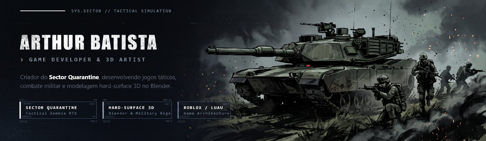

<div align="center">

  <!-- BANNER TÁTICO MILITAR - ESTILO GHPC / BATTLEFIELD -->
  

  <br />

  <!-- TYPING SVG DINÂMICO -->
  <a href="https://github.com/ArthurBatista279">
    
  </a>

  <br />

  <!-- BADGES TÁTICOS -->
  <p>
    
    <a href="https://github.com/ArthurBatista279?tab=followers">
      
    </a>
    <a href="https://github.com/ArthurBatista279?tab=repositories">
      
    </a>
    <a href="https://www.linkedin.com/in/arthur-batista-oliveira-bb8018358/">
      
    </a>
    <a href="mailto:barthur.oliveira07@gmail.com">
      
    </a>
  </p>

</div>

---

## `>_` Sobre Mim

```yaml
desenvolvedor: "Arthur Batista Oliveira"
formacao: "Desenvolvimento de Sistemas — SENAI"
atuacao: ["Game Development (Roblox Studio / Luau)", "Modelagem 3D Militar (Blender)", "Engenharia de Software (C# / .NET)"]
projeto_em_destaque: "Sector Quarantine"
```

Desenvolvedor de jogos e programador de software com foco em **jogos de estratégia em tempo real (RTS)**, mecânicas de combate e **modelagem 3D hard-surface de veículos militares**. 

Combino programação de sistemas e arte técnica 3D para construir experiências imersivas, desde a criação da estética e dos modelos até o código de gameplay que dá vida ao jogo.

---

## `★` Projeto Principal: Sector Quarantine

<div align="center">
  <table width="100%">
    <thead>
      <tr>
        <th width="100%" align="left">
          <h3>🎖️ Sector Quarantine — Zombie RTS Tático & Sobrevivência</h3>
        </th>
      </tr>
    </thead>
    <tbody>
      <tr>
        <td align="left">
          <p>
            
            
            
          </p>
          <p>
            Jogo de estratégia militar onde os jogadores assumem o comando da <strong>FCDC (Frente de Contenção e Defesa Civil)</strong> para conter um surto biológico devastador em uma cidade em quarentena.
          </p>
          <h4>O que estou construindo no projeto:</h4>
          <ul>
            <li><strong>Direção de Arte & Modelagem 3D:</strong> Modelagem de blindados militares clássicos (M2 Bradley, Humvee M1114) e infantaria tática com foco em autenticidade e visual sério.</li>
            <li><strong>Sistemas de Combate e Tropas:</strong> Controle de esquadrões, comandos de campo em tempo real, suporte de artilharia e gerenciamento de sobreviventes.</li>
            <li><strong>Combate Veicular:</strong> Blindados de transporte e ataque equipados com sistemas de defesa, torres operacionais e suporte direto à infantaria.</li>
          </ul>
        </td>
      </tr>
    </tbody>
  </table>
</div>

---

## `📊` Atividade no GitHub

<div align="center">

  <!-- LINHA 1: STREAK STATS + RESUMO GERAL -->
  <a href="https://github.com/ArthurBatista279">
    
  </a>
  <a href="https://github.com/ArthurBatista279">
    
  </a>

  <br /><br />

  <!-- LINHA 2: LINGUAGENS POR REPOSITÓRIO + LINGUAGENS POR COMMIT -->
  <a href="https://github.com/ArthurBatista279?tab=repositories">
    
  </a>
  <a href="https://github.com/ArthurBatista279?tab=repositories">
    
  </a>

  <br /><br />

  <!-- LINHA 3: ATIVIDADE EM TEMPO REAL -->
  <a href="https://github.com/ArthurBatista279">
    
  </a>

</div>

---

## `🛠️` Áreas de Domínio & Ferramentas

<div align="center">

  ### Desenvolvimento de Jogos & Arte 3D
  <p>
    
    
    
    
    
  </p>

  ### Programação & Engenharia de Software
  <p>
    
    
    
    
    
  </p>

</div>

---

## `📫` Contato & Redes

<div align="center">
  <p>Aberto para oportunidades, conexões na indústria de jogos e novos projetos.</p>
  <p>
    <a href="https://www.linkedin.com/in/arthur-batista-oliveira-bb8018358/">
      
    </a>
    <a href="mailto:barthur.oliveira07@gmail.com">
      
    </a>
    <a href="https://github.com/ArthurBatista279?tab=repositories">
      
    </a>
  </p>
</div>
